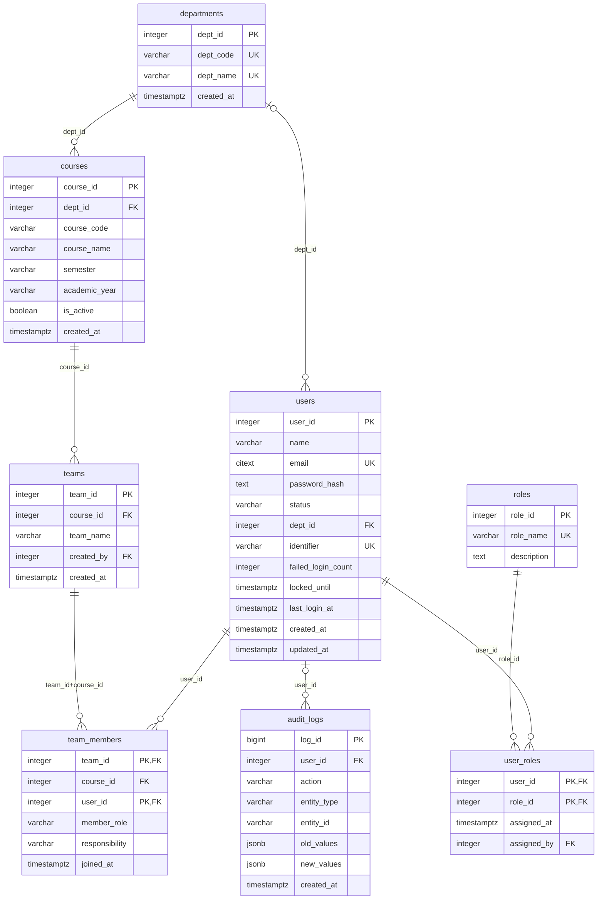
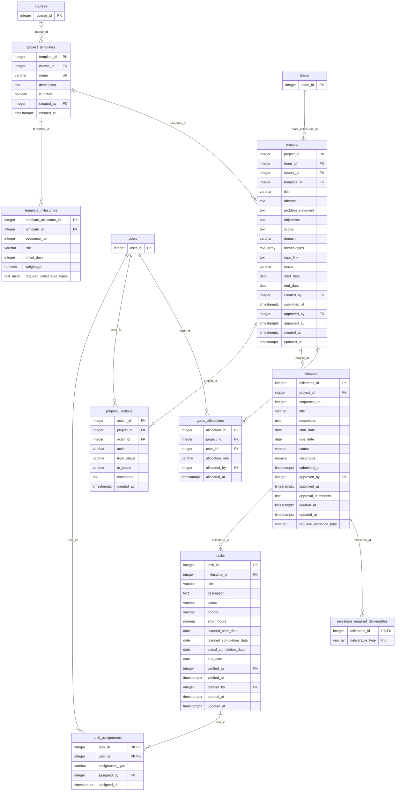
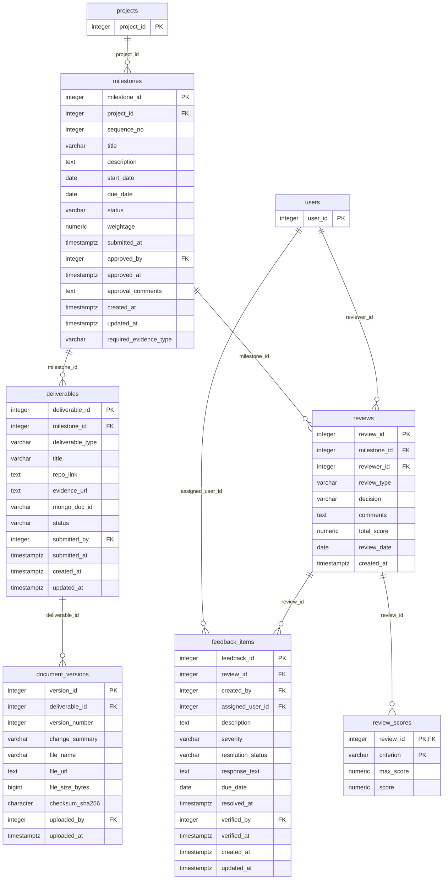
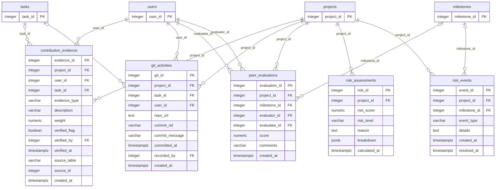
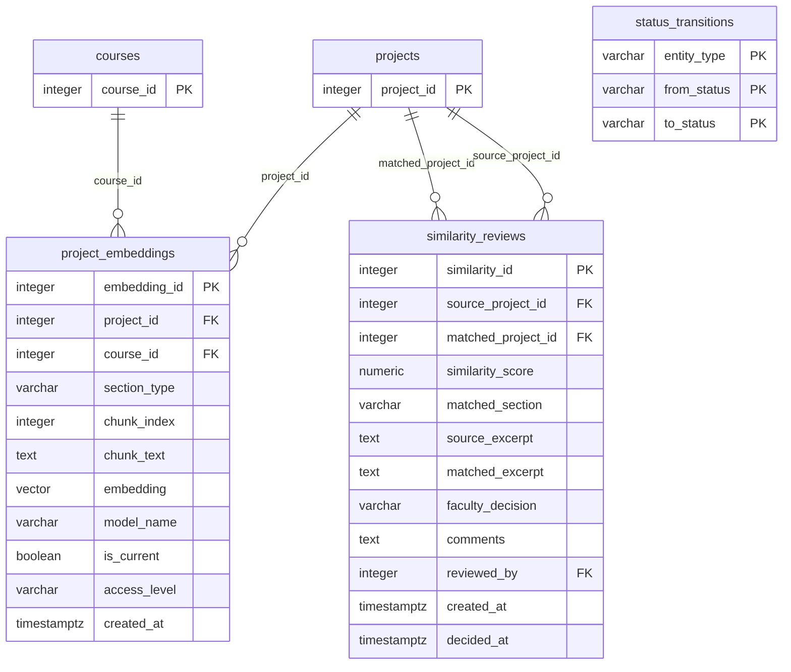

# Entity-relationship diagrams by domain

_Generated from the live catalogue. Tables drawn with all attributes belong to the domain; tables shown with only their key are referenced from another domain. Actor columns such as created_by, approved_by and verified_by (all foreign keys to users) are marked FK in the boxes but not drawn as lines, to keep the pictures readable._

## ER 1. Identity, academic context and teams

Who the users are, the departments and courses they belong to, and how students form teams (one team per student per course).

## ER 2. Projects, allocation and planning

A team owns one active project; guides and reviewers are allocated; milestones and tasks plan the work; templates seed the plan.

## ER 3. Deliverables, review and feedback

Submissions with versions, milestone reviews with rubric scores, and trackable feedback assigned to a student.

## ER 4. Evidence, contribution and risk

Verifiable evidence per student, commit references, peer ratings, and the stored delivery-risk assessments and events.

## ER 5. Originality (vector) and workflow control

Embeddings of proposal sections (pgvector) and the faculty decisions on possible overlap; the table that lists every legal status change.

